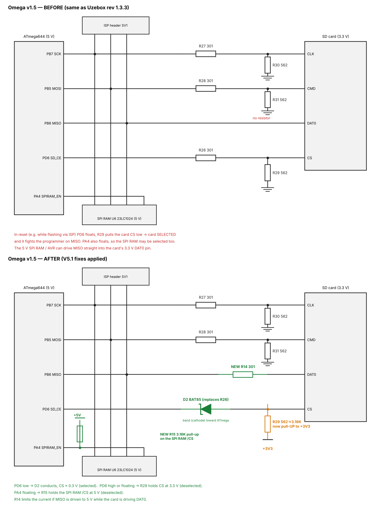
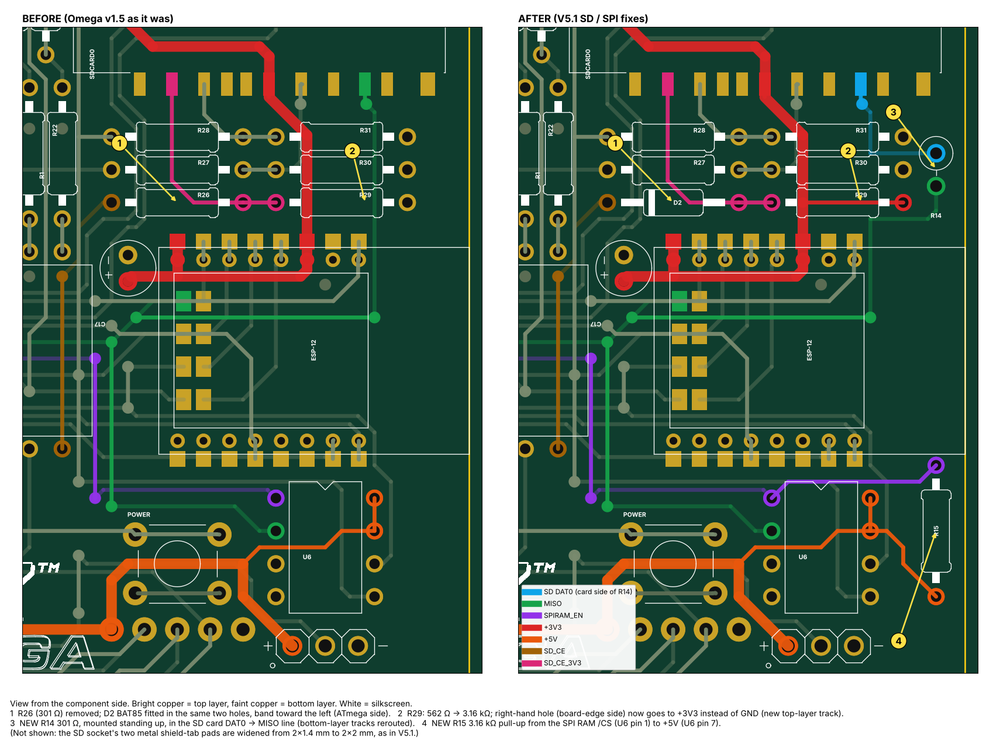
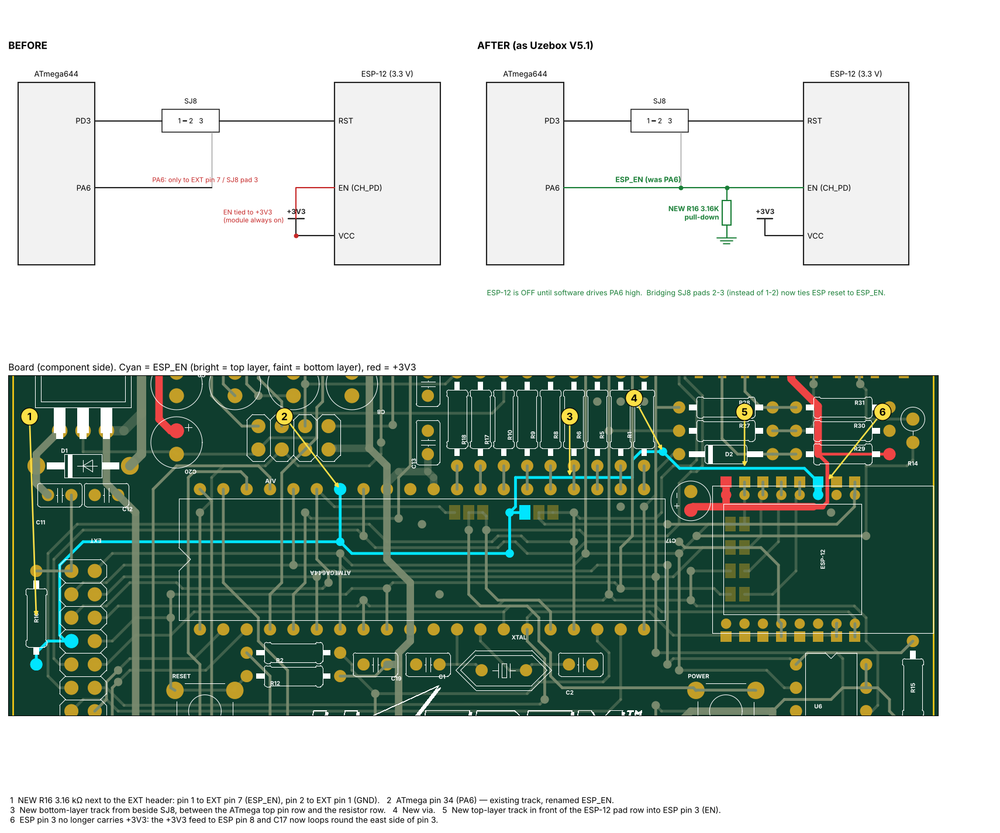

# Omega v1.5 — SD card / SPI and ESP-12 enable fixes ported from Uzebox V5.1

Uze's `UzeboxV5.1` branch fixes three problems on the shared SPI bus of the Uzebox rev 1.3.3 (V5.0) board.
The Omega v1.5 had exactly the same SD-card circuit as rev 1.3.3, so it had the same problems.
This change applies the same fixes to the Omega, using the Omega's own part numbers and board layout.

Uze's original explanation: `schematics/Uzebox/V5.1/assets/sd-cs-fix.png` in the Uzebox repo.

## What was wrong

* **SD card selected during reset / ISP flashing.** In reset the ATmega's pins float. The 562 Ω pull-down R29
  then dragged the SD card's CS low, so the card was *selected* and could fight the programmer on MISO.
* **SPI RAM selected during reset.** The SPI RAM's /CS (PA4, `SPIRAM_EN`) had no pull-up, so it could float low.
* **5 V driven into the SD card.** The 5 V SPI RAM (or the AVR during ISP) could drive MISO straight into the card's 3.3 V DAT0 pin.

## What changed

| # | Part | Before | After | Why |
|---|------|--------|-------|-----|
| 1 | **R26** → **D2** | 301 Ω resistor in series with SD CS | **BAT85 Schottky diode**, band (cathode) towards the ATmega (PD6 / `SD_CE`) | PD6 can pull CS low through the diode, but can't push 5 V into the card |
| 2 | **R29** | 562 Ω from SD CS to **GND** (pull-down) | **3.16 kΩ** from SD CS to **+3V3** (pull-up) | Card stays deselected when PD6 is high or floating |
| 3 | **R14** (new) | — | **301 Ω** in series between SD DAT0 and MISO | Limits current if MISO is driven to 5 V |
| 4 | **R15** (new) | — | **3.16 kΩ** from SPI RAM /CS (`SPIRAM_EN`) to **+5V** | SPI RAM stays deselected while the AVR is in reset |
| 5 | SD socket shield tabs | pads 2 × 1.4 mm | pads 2 × 2 mm | Same "Widened SD socket tabs" change as V5.1 (stronger solder joint) |

Uze reused the numbers R12/R4/R29 for these parts on V5.1. On the Omega, R4, R12 and R13 are already used
(S-Video, reset and composite sync), so the new parts are numbered **R14** and **R15** (both were unused here),
and R29 keeps its number and position.

### Shopping-list (BOM) differences
* **Remove:** one 301 Ω (old R26) and one 562 Ω (old R29).
* **Add:** one BAT85 Schottky diode (D2), three 3.16 kΩ (R29, R15, R16 — R16 is the ESP-12 enable pull-down below) and one 301 Ω (R14).
* Net effect: 562 Ω count −1, 3.16 kΩ count +3, 301 Ω count unchanged, +1 BAT85.

## Where the parts are on the board

* **D2** goes into R26's old holes. The holes keep the 10.16 mm (0.4") spacing so no tracks moved;
  the new footprint `DO35-10` is a DO-35 diode body on that spacing (BAT85 is a DO-35 part).
* **R29** stays where it is. Its right-hand hole (board-edge side) is now joined to the +3V3 track by a short
  top-layer track instead of going to the ground pour.
* **R14** stands upright (same `0207_2V` footprint as R13) in the narrow strip right of R29–R31.
  The bottom-layer MISO track that ran straight down from the SD card was split so it passes through R14.
  The ESP-12 module covers the board edge below this, so the resistor has to stand up.
* **R15** lies vertically to the right of the SPI RAM (U6). It is placed clear of the ESP-12 module outline above it
  and the rubber-foot outline in the corner below it. New top-layer tracks run from U6 pin 1 and U6 pin 7.

## ESP-12 enable on PA6 (also from V5.1)

Uzebox V5.1 uses **PA6 (ATmega pin 34) as `ESP_EN`**, which drives the ESP-12's EN (CH_PD) pin, with a 3.16 kΩ
pull-down so the module stays **off** until software sets PA6 high. Before this change, the Omega tied the ESP's EN
pin straight to +3V3, so the module was always on, and PA6 only went to EXT pin 7 and SJ8 pad 3.

| Part / net | Before | After |
|---|---|---|
| ATmega pin 34 (PA6) | net `PA6` | net **`ESP_EN`** (same tracks) |
| ESP-12 pin 3 / P$3 (EN, CH_PD) | +3V3 | **`ESP_EN`** |
| **R16** (new) | — | **3.16 kΩ** from `ESP_EN` to GND (V5.1 calls it R13; R13 is already used on the Omega) |
| EXT pin 7 | `PA6` | `ESP_EN` (same pin, same as V5.1's EXT pin 7) |
| SJ8 pad 3 | `PA6` | `ESP_EN` |

On the board:
* A new bottom-layer track runs from beside SJ8, between the ATmega's top pin row and the resistor row, to a new via.
  From there a new top-layer track runs along the front of the ESP-12 pad row into ESP pin 3.
* ESP pin 3 used to be part of the +3V3 feed to ESP pin 8 and C17. That feed now loops round the east side of pin 3
  (between pins 3 and 2).
* **R16** lies vertically just left of the EXT header. Short top-layer tracks run to EXT pin 7 (`ESP_EN`) and
  EXT pin 1 (GND).

**SJ8 / USB-serial option still works.** SJ8 used to let you move the ESP reset from PD3 to PA6, which frees PD3
(UART1 TX) for the optional USB-serial adapter. Its pad 3 is now `ESP_EN`, so cutting the 1–2 link and bridging
2–3 ties the ESP's RESET to its EN line. Both are then driven by PA6, which is a standard ESP-8266 hookup:
PA6 high = ESP running, PA6 low = ESP off and held in reset. The R16 pull-down keeps it off by default in that
mode too.

**Software:** firmware that expects the ESP-12 to be always on must now set PA6 as an output and drive it high,
as the Uzebox V5.1 board requires. Until it does, the module stays off.

## Not ported (and why)

* **Straight ISP header removed, mounting holes added, label tweaks** — specific to the Uzebox V5.1
  board layout; the Omega already has its own ISP header (SV1) and mounting holes.

## Before you order boards

These edits were made directly in the KiCad 10 files and checked with scripts (connectivity, track-to-track
clearance, board-edge clearance, and a before/after schematic netlist comparison). They have **not** been opened
in KiCad yet, so please:

1. Open the project in **KiCad 10**.
2. In the PCB editor press **B** (*Edit → Fill All Zones*). The ground pours were trimmed back from the new
   copper so the stored fill is safe, but a proper refill will tidy them up (e.g. fill the gap where the old MISO
   track ran, and give R29 its new clearance properly).
3. Run **ERC** in the schematic and **DRC** in the PCB editor.
4. Optionally run *Tools → Update PCB from Schematic*; it should find nothing important to change
   (it may rename the new net between the SD card and R14).
   Because the ground pour was trimmed around the new tracks, a few small islands of pour were removed; the refill
   in step 2 recalculates all of this.
5. Tidy the silkscreen as you like. Labels to look at: **D2** (inside the diode body), **R14** (below the upright
   resistor, near the board edge), **R15** and **R16** (inside their bodies). Check that the D2 band marking is clear,
   because the diode only works one way round.

As with V5.1, these fixes are "proposed, not yet built or tested" until a board is assembled and an SD card is tried.
